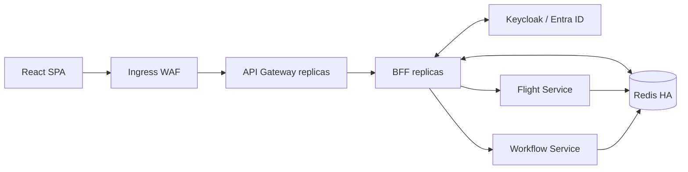

# Distributed BFF and API Gateway architecture

## Boundaries
1. Browser uses only a secure HttpOnly session cookie and a separate CSRF token. No browser bearer tokens.
2. Gateway forwards authenticated browser traffic to BFF and never trusts client-supplied identity headers.
3. BFF is the OIDC confidential client. It stores authorized clients in Redis-backed sessions and performs downstream token relay.
4. Flight and Workflow validate JWT signatures, issuer, audience, expiration and application authorization independently.
5. Redis tracks sessions, token revocation and account-level session epoch / deny state.

## Distributed refresh
Use an atomic per-session refresh lock with lease ownership and fencing/version checks. Under the lock, reload authorized-client state, refresh once, and compare-and-set the updated token version. Reject stale writers. On IdP refresh failure, invalidate the affected session; never reuse an invalidated refresh token.

## Revocation
Store a digest of each revoked access token with TTL bounded by its expiry. For immediate user-wide blocking, check a central disabled-user / not-before policy in addition to JWT validation. Define fail-closed behavior, Redis HA and latency budgets.

## Logout
Require CSRF-protected POST. Atomically mark session invalid, revoke all tracked access tokens where required, remove authorized-client state, clear browser cookie and redirect to IdP RP-initiated logout. Handle partial failure explicitly.

## Production guardrails
HTTPS only, PKCE S256, SameSite cookie policy, strict redirect URI allowlist, CSRF protection, mTLS/network policies for internal traffic, scoped OAuth audience, timeouts, rate limiting, observability without token leakage.
