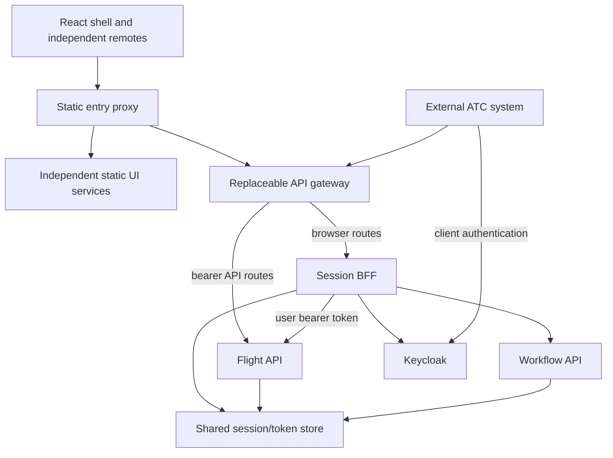

# Architecture and design principles

## Logical view

## Decisions

1. **Separate static hosting:** UI deployment never requires rebuilding the gateway. Runtime manifest `/mfe-manifest.json` selects remotes. Each remote exposes mount/unmount and owns its React root. It bundles React independently for predictable isolation of UI lifecycle; this costs extra bytes. Same-page MFEs share JS privileges and are not a security boundary.
2. **Gateway-neutral contracts:** standard HTTPS/WSS, OIDC, bearer headers, Problem Details and stable BFF/domain paths. Gateway is Spring Cloud Gateway WebFlux reference. Replace it by reproducing the route/security contracts, not by changing frontend/domain business logic.
3. **BFF owns browser authentication:** confidential OIDC client, explicit PKCE S256, opaque HttpOnly cookie, CSRF, encrypted token state. Redis is shared and authoritative; authorized clients are not stored solely in pod memory.
4. **Resource servers enforce access:** gateway validation is defence in depth. Flight/Workflow independently validate tokens, intended audience and revocation. Flight applies FLIGHT_VIEW/FLIGHT_UPDATE plus `terminals` claims. Missing scope denies access. List filtering precedes response generation. Demo claims are issued by controlled Keycloak mappers; a production entitlement service can replace them with defined freshness.
5. **Machine clients bypass BFF:** ATC obtains its own token, calls `/api/v1/flights`, and cannot write. Each partner gets a separate client and scoped service account.
6. **Operational and studio privileges differ:** platform administrator does not gain business privileges merely by name. The demo admin has explicitly assigned roles. Workflow Studio editing/publishing is outside this reference; no workflow engine or manifest compiler is claimed.
7. **State limits:** demo Flight map has one writer process. Its synchronized ETag updates prevent local lost updates, not cross-pod writes. A production implementation requires persistent transactions, versioned rows and audit/outbox.

## Browser flow

1. Browser fetches static UI from port 8088, independently of gateway deployment.
2. `/bff/api/v1/session` through gateway returns JSON 401 until login.
3. Browser navigates `/oauth2/authorization/aobp`; BFF creates state/nonce/PKCE and redirects to Keycloak.
4. Keycloak returns a code to exact `http://localhost:8088/login/oauth2/code/aobp`.
5. BFF exchanges it server-to-server, verifies ID token, stores encrypted authorized-client data and session.
6. Browser sends AOBPSESSION cookie; BFF sends Authorization: Bearer to private API. Refresh token never reaches gateway business routes or React.
7. API validates JWT, checks revocation/role/terminal, returns authorized JSON.
8. Mutation fetches CSRF, gets an ETag, then PATCHes with If-Match; API rejects stale writes.
9. POST logout requires CSRF, writes deny records for tracked tokens, removes authorized client, invalidates session and performs OIDC logout.

## ATC flow

1. Registered `atc-prod` authenticates at Keycloak token endpoint using Client Credentials.
2. Keycloak issues token for Flight API; scope T1, role FLIGHT_VIEW only.
3. ATC calls gateway port 8080 `/api/v1/flights` with Bearer header.
4. Gateway validates signature/issuer/expiry/audience; no login redirect and no BFF.
5. Flight validates independently, checks revoked token/blocked subject and scopes query.
6. ATC reacquires a token before expiry. Writes fail 403; T2 access is denied/concealed.

## Refresh and failure semantics

Tokens are renewed within a 90-second expiry window. A per-session Redis lease serializes refresh. The repository saves refreshed data only if the lease owner still matches, using one Lua operation. A worker that loses the lease cannot overwrite newer data. This prevents stale saves; it does not make a refresh call to Keycloak and a Redis save one distributed transaction. A crash after refresh rotation can require reauthentication. See refresh-limitation.md.

Expired token validation occurs at request entry; a token expiring during accepted work does not automatically abort that work. Later service calls still need valid credentials. No automatic mutation retries. Invalid-grant ends the affected BFF session. Redis failure fails protected API access closed with 503. Keycloak outage does not justify anonymous access.

Logout tracks all issued token digests for that BFF session and blocks them for 360 seconds. This relies on the generated realm's maximum access-token lifetime of 300 seconds. Changing token lifetime requires changing the revocation bound. User-wide block is enforced at every domain request; it does not delete the user in Keycloak. Provisioning, SCIM and federated logout require production-specific integration.

## Realtime contract

Native WebSocket `/bff/ws/v1` uses existing BFF principal, exact allowed origin and periodic session/subject-block checks. Browser receives a refresh hint every five seconds, then refetches authorized REST data. No flight payload is broadcast. This is a polling-backed reference, not broker-driven event delivery. External ATC updates would be observed on the next refresh. Multiple BFFs can independently emit hints; no cross-replica data fan-out is implied. Session expiry/blocks close sockets within the checking interval plus store latency. Persistent outage closes fail-safe. Heartbeats do not renew sessions.

## Trust/deployment boundaries

Local UI entry is 8088, gateway API 8080, identity 8085. Internal APIs are 8091/8092 and BFF 8081. Production must use private service networks and authenticated TLS, exact public DNS/redirects, protected management ports and explicit proxy allowlists. Do not expose API/Redis/Keycloak administration through public catch-all routes. Monitoring is a separate management boundary.

## Code ownership boundaries

`FlightController` is the HTTP adapter, `FlightService` owns the reference use cases and conditional state changes, and `FlightPolicy` evaluates role/terminal access. Shared service-support owns the JWT/revocation and Problem Details conventions. BFF OAuth storage/refresh, relay and WebSocket lifecycle are separate collaborators. This separation avoids moving business authorization into gateway filters or React.
